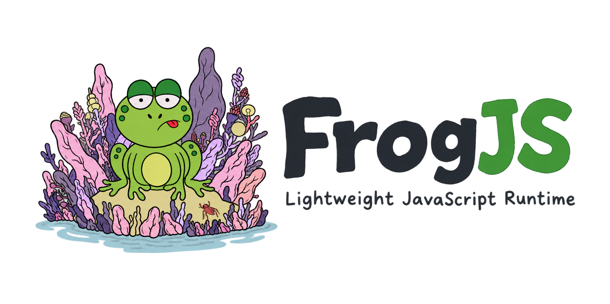

[](https://github.com/dev-frog/frogJs/actions/workflows/build.yml)
[](https://github.com/dev-frog/frogJs/actions/workflows/release.yml)
[](https://github.com/dev-frog/frogJs/releases/latest)

**FrogJS** is a lightweight JavaScript runtime built on V8 and libuv, designed for server-side JavaScript development. Inspired by Node.js architecture, FrogJS provides a minimal yet powerful environment with CommonJS module support, HTTP and TCP networking, file I/O, and asynchronous operations.

---

## Features

- **V8 JavaScript Engine**: Fast ECMAScript execution with modern JavaScript support
- **Event-Driven I/O**: Non-blocking operations powered by libuv
- **Module System**: CommonJS-style `require()` with caching and relative path support
- **HTTP Server & Client**: Node-compatible `http` module (keep-alive, chunked encoding, pipelining)
- **Events & Streams**: Node-compatible `EventEmitter` and `stream` module (Readable, Writable, Transform, pipe with backpressure)
- **TCP Networking**: Built-in TCP server and client functionality
- **File System**: Both sync and async file operations
- **Timer API**: setTimeout, setInterval, clearTimeout, clearInterval
- **Process & Buffer**: `process` object and `Buffer` class for binary data
- **Path & OS Utilities**: Node-compatible `path` and `os` modules
- **REPL & CLI**: Interactive shell with history and tab completion, `--eval`/`--print`/`--check`, Node-style error reports
- **Util**: `util.inspect` and `util.format` with the same output as Node.js (used by `console.log`)
- **Clean Architecture**: Minimal C++ codebase with clear separation of concerns

---

## Prerequisites

Before building FrogJS, ensure you have the following dependencies:

### macOS (Homebrew)
```bash
brew install v8 libuv
```

### Linux (Ubuntu/Debian)
```bash
# V8 requires building from source or using distro packages
sudo apt-get install libuv1-dev
```

### Build Requirements
- **C++ Compiler**: GCC (Linux) or Clang (macOS) with C++17 support
- **Make**: For building via Makefile
- **CMake**: Optional, for cross-platform builds (requires custom V8 config)

---

## Installation

### Download a Prebuilt Release (macOS Apple Silicon)

Prebuilt binaries are published on the [Releases page](https://github.com/dev-frog/frogJs/releases) for every version tag.

```bash
brew install v8 libuv   # runtime dependencies (linked dynamically)

VERSION=0.5.0   # pick a version from the Releases page
curl -LO https://github.com/dev-frog/frogJs/releases/download/v$VERSION/frogjs-$VERSION-macos-arm64.tar.gz
curl -LO https://github.com/dev-frog/frogJs/releases/download/v$VERSION/frogjs-$VERSION-macos-arm64.tar.gz.sha256
shasum -a 256 -c frogjs-$VERSION-macos-arm64.tar.gz.sha256

tar -xzf frogjs-$VERSION-macos-arm64.tar.gz
./frogjs-$VERSION-macos-arm64/frogjs your-script.js
```

### Clone the Repository
```bash
git clone https://github.com/dev-frog/frogJs.git
cd frogJs
```

### Build (macOS with Homebrew)
```bash
make clean
make
```

The executable will be created at `./build/frogjs`

### Build (Linux)
Update the Makefile paths to point to your V8 and libuv installations:
```bash
# Edit Makefile with your paths
make
```

---

## Quick Start

### Hello World
Create `hello.js`:
```javascript
console.log("Hello from FrogJS! 🐸");
```

Run it:
```bash
./build/frogjs examples/hello.js
```

### REPL
Run `frogjs` with no script to start an interactive shell:
```
$ ./build/frogjs
Welcome to FrogJS v0.6.0.
Type ".help" for more information.
> const server = { port: 3000, routes: ['/', '/api'] }
undefined
> server
{ port: 3000, routes: [ '/', '/api' ] }
> process.ver<Tab>
process.version   process.versions
```

- **Editing**: arrow keys, Home/End, Ctrl+A/E/K/U/W, Ctrl+L to clear the screen
- **History**: Up/Down, saved to `~/.frogjs_repl_history` (set `FROGJS_REPL_HISTORY` to change it, or to an empty string to disable it)
- **Tab completion** for globals, keywords, your `let`/`const` names, object properties and REPL commands
- **Multi-line input**: unfinished code continues on a `...` prompt
- `_` holds the last result and `_error` the last error
- **Commands**: `.help`, `.exit`, `.clear` (fresh context), `.break`, `.load <file>`, `.save <file>`
- **Ctrl+C** clears the line or stops running code (e.g. an endless loop); press it twice on an empty line, or Ctrl+D, to exit
- Timers and servers keep running between prompts

### Command Line
```bash
frogjs script.js [args...]        # run a script
frogjs -e "console.log(1 + 1)"    # evaluate code
frogjs -p "os.cpus().length"      # evaluate and print the result
frogjs -c script.js               # syntax check only
frogjs -i -e "var x = 1"          # run code, then start the REPL
echo "console.log('hi')" | frogjs # read the script from stdin
frogjs --version                  # v0.6.0
frogjs --help                     # all options
```

Uncaught errors are reported like Node.js does, and the process exits with code 1:
```
app.js:3
  return user.name;
              ^

TypeError: Cannot read properties of undefined (reading 'name')
    at getName (app.js:3:15)
    at app.js:6:1
```

### HTTP Server
```javascript
const http = require('http');

const server = http.createServer((req, res) => {
    res.setHeader('Content-Type', 'text/plain');
    res.end(`You requested ${req.method} ${req.url}\n`);
});

server.listen(3000, () => {
    console.log('Listening on http://localhost:3000');
});
```

### HTTP Client
```javascript
const http = require('http');

http.get('http://localhost:3000/hello', (res) => {
    let body = '';
    res.on('data', (chunk) => body += chunk);
    res.on('end', () => console.log(res.statusCode, body));
});
```

### Events & Streams
```javascript
const http = require('http');
const EventEmitter = require('events');
const { Transform, pipeline } = require('stream');

const bus = new EventEmitter();
bus.on('upload', (bytes) => console.log(`received ${bytes} characters`));

// Stream each request body back upper-cased, with backpressure handled by pipeline()
http.createServer((req, res) => {
    let size = 0;
    const upper = new Transform({
        transform(chunk, encoding, callback) {
            size += chunk.length;
            callback(null, String(chunk).toUpperCase());
        },
    });
    pipeline(req, upper, res, (err) => {
        if (!err) bus.emit('upload', size);
    });
}).listen(3000);
```

### TCP Server
Create a simple TCP server:
```javascript
const net = require('net');

const server = net.createServer((socket) => {
    socket.on('data', (data) => {
        console.log('Received:', data.toString());
        socket.write('Echo: ' + data);
    });

    socket.on('end', () => {
        console.log('Client disconnected');
    });
});

server.listen(3000, () => {
    console.log('Server listening on port 3000');
});
```

### File Operations
```javascript
const fs = require('fs');

// Async read
fs.readFile('example.txt', (err, data) => {
    if (err) throw err;
    console.log(data);
});

// Sync write
fs.writeFileSync('output.txt', 'Hello, FrogJS!');
```

### Modules
```javascript
// math.js
const add = (a, b) => a + b;
module.exports = { add };

// app.js
const math = require('./math');
console.log(math.add(1, 2)); // 3
```

---

## Examples

Check out the `examples/` directory for more samples:
- `examples/timers.js` - Timer API usage
- `examples/fs-sync.js` - Synchronous file operations
- `examples/fs-async.js` - Asynchronous file operations
- `examples/http-server.js` - HTTP server with basic routing
- `examples/http-client.js` - HTTP client (GET and POST)
- `examples/test-http.js` - HTTP module self-test
- `examples/events-streams.js` - EventEmitter, Transform and HTTP streaming demo
- `examples/test-events.js` - Events module self-test
- `examples/test-streams.js` - Stream module self-test
- `examples/tcp-server.js` - TCP server implementation
- `examples/tcp-client.js` - TCP client implementation
- `examples/modules/` - Module system examples
- `examples/test-path.js` - Path module usage
- `examples/test-os.js` - OS module usage
- `examples/test-util.js` - Util module self-test (`inspect`, `format`)
- `examples/test-cli.sh` - CLI and REPL self-test

Run examples:
```bash
./build/frogjs examples/timers.js
./build/frogjs examples/http-server.js
./build/frogjs examples/tcp-server.js
./build/frogjs examples/modules/main.js
```

---

## Project Structure

```
frogjs/
├── src/
│   ├── core/
│   │   ├── runtime.cpp       # Main entry point, command-line options, console
│   │   ├── repl.cpp          # Interactive REPL
│   │   └── line_editor.cpp   # Line editing, history and completion for the REPL
│   └── bindings/
│       ├── process.cpp      # process object
│       ├── buffer.cpp       # Buffer class
│       ├── timers.cpp       # Timer API
│       ├── fs.cpp           # File system API
│       ├── net.cpp          # TCP networking
│       ├── events.cpp       # EventEmitter (embedded JS)
│       ├── stream.cpp       # Readable/Writable/Duplex/Transform (embedded JS)
│       ├── http.cpp         # HTTP server & client (JS on top of net)
│       ├── path.cpp         # Path utilities
│       ├── os.cpp           # OS information
│       ├── util.cpp         # util.inspect / util.format (embedded JS)
│       └── modules.cpp      # Module system
│   └── utils/
│       ├── js_module.cpp    # Loader for modules written in embedded JS
│       └── errors.cpp       # Node-style uncaught error reports
├── examples/                # Example scripts
├── docs/                    # Documentation
├── include/frogjs/          # Shared headers (V8 compat, Buffer, JS module loader)
├── Makefile                 # Build configuration
├── CMakeLists.txt          # CMake build (in development)
├── README.md               # This file
├── FEATURES.md             # Detailed feature list
└── note.md                 # Development notes
```

---

## Current Status

### Implemented
- Core runtime with V8 integration
- Console API (log, info, debug, error, warn) with `util.format` formatting
- Timer API (setTimeout, setInterval, etc.)
- File system operations (sync & async)
- TCP server/client networking
- HTTP server/client (http.createServer, http.request, http.get)
- Events module (EventEmitter, events.once, events.on)
- Streams (Readable, Writable, Duplex, Transform, PassThrough, pipeline, finished)
- Module system (require, exports, caching)
- Error handling with stack traces and source excerpts
- REPL (history, tab completion, multi-line input, commands)
- CLI options (--eval, --print, --check, --interactive, --version, --help)
- Util module (inspect, format, promisify, inherits, isDeepStrictEqual)
- Process object (argv, execArgv, env, exit, cwd, pid, platform, version, versions)
- Buffer class for binary data
- Additional FS operations (mkdir, rmdir, stat, readdir, unlink, existsSync)
- Path module (join, resolve, normalize, dirname, basename, extname, isAbsolute)
- OS module (platform, arch, cpus, hostname, release, type, totalmem, freemem, homedir, tmpdir)
- Automated release builds via GitHub Actions

### Planned
- File streams (fs.createReadStream / fs.createWriteStream)
- Crypto module
- Worker threads
- Windows support

---

## Documentation

- **[FEATURES.md](FEATURES.md)** - Comprehensive feature documentation
- **[note.md](note.md)** - Development guide and implementation notes
- **[steps.md](steps.md)** - Step-by-step implementation guide
- **[RELEASE_GUIDE.md](RELEASE_GUIDE.md)** - How to cut a release

---

## Building from Source

### Makefile Build (Recommended for macOS)
```bash
make clean
make
./build/frogjs your-script.js
```

### CMake Build (In Development)
```bash
mkdir -p build && cd build
cmake ..
make
./frogjs your-script.js
```

---

## Performance

- **Startup Time**: ~50-100ms (V8 initialization)
- **Memory Usage**: Minimal overhead
- **Event Loop**: Efficient libuv integration
- **JIT Compilation**: Full V8 optimizations

---

## Releasing

Releases are automated with GitHub Actions ([`.github/workflows/release.yml`](.github/workflows/release.yml)).
Each release builds FrogJS on macOS, runs a smoke test, and publishes a GitHub Release with the
`.tar.gz` binary, a SHA-256 checksum, and notes generated from the commits since the previous tag.

Start a release in either of these ways:

```bash
# 1. Push a tag (via the helper script or directly)
./release.sh v0.5.0
git tag -a v0.5.0 -m "Release v0.5.0" && git push origin v0.5.0

# 2. Trigger from GitHub (the workflow creates the tag for you)
gh workflow run release.yml -f version=v0.5.0
#    or: Actions → Release → Run workflow
```

Versions with a suffix such as `v0.5.0-rc.1` are published as pre-releases.
CI for pushes and pull requests runs separately in [`.github/workflows/build.yml`](.github/workflows/build.yml).
See [RELEASE_GUIDE.md](RELEASE_GUIDE.md) for details.

---

## Contributing

Contributions are welcome! Please feel free to submit pull requests or open issues for bugs and feature requests.

### Development Setup
1. Fork the repository
2. Create a feature branch
3. Make your changes
4. Test thoroughly with the examples
5. Submit a pull request

---

## License

MIT License - See LICENSE file for details

---

## Acknowledgments

- **V8 Team** - For the amazing JavaScript engine
- **libuv Team** - For the excellent I/O library
- **Node.js** - For architectural inspiration

---

**Version**: 0.6.0 (Development) — see [Releases](https://github.com/dev-frog/frogJs/releases) for the latest
**Status**: Active Development
**Last Updated**: 2026-10-16

## Support 🐸

If you enjoy using FrogJS, consider giving it a ⭐ on GitHub! For questions or feedback, open an issue or reach out to us.
